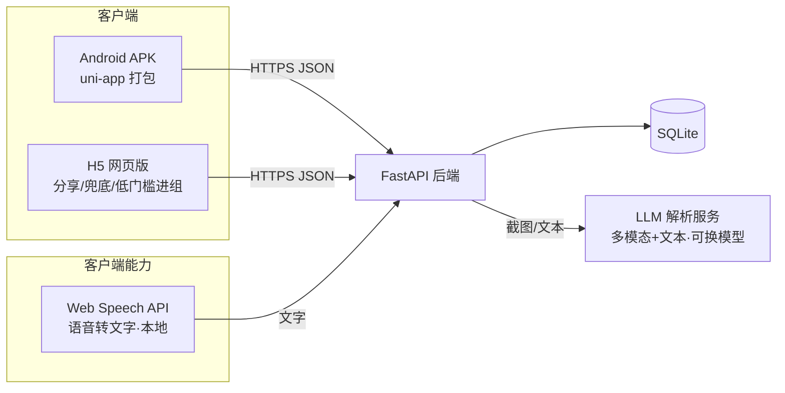
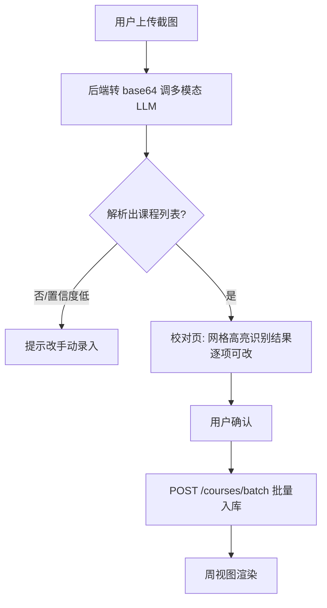
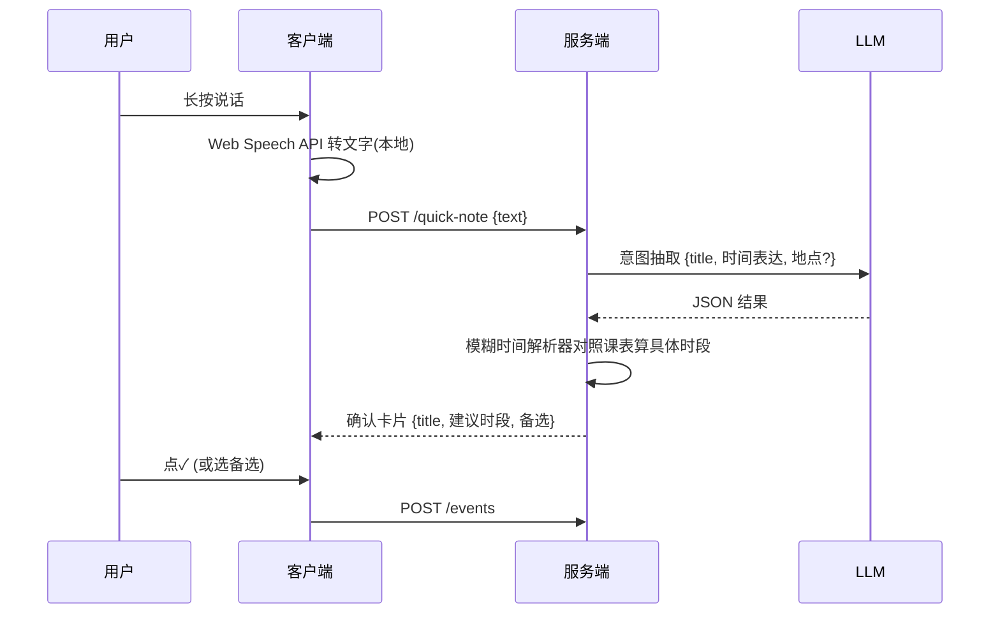
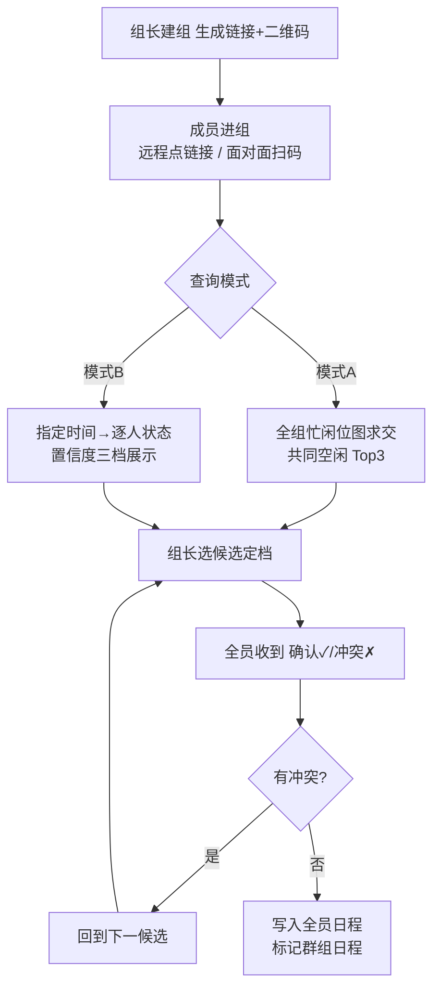

# 概要设计说明书

项目名称：大学生日程管理工具 ｜ 版本：v0.2 ｜ 日期：2026-11-07

---

## 1. 系统架构

**分层说明**：
- **客户端层**：uni-app（Vue3）一套代码编译 APK 与 H5；语音识别在骨架版用浏览器 Web Speech API 本地完成（零成本），正式版可替换为云 ASR；
- **服务层**：FastAPI 提供 REST 接口，承载全部业务逻辑；
- **数据层**：SQLite（骨架版单文件库，可平滑迁移 PostgreSQL）；
- **AI 层**：独立"解析服务"模块封装多模态 LLM 调用（课表解析、DDL 抽取、速记意图抽取），模型可配置替换，业务代码不直接耦合任何厂商 SDK。

## 2. 模块划分

| 模块 | 职责 | 主要接口 |
|------|------|---------|
| M1 学期与课表 | 学期配置、教学周推算、课程 CRUD、周视图数据 | /api/terms、/api/courses |
| M2 速记解析 | 语音/文字 → 意图抽取 → 模糊时间解析 → 日程入库 | /api/quick-note |
| M3 DDL 与推荐 | DDL 采集抽取、倒计时墙、空闲池计算、建议生成与反馈 | /api/ddls、/api/suggestions |
| M4 组队查询 | 建组进组、忙闲位图、共同空闲、指定时间查询、定档确认 | /api/groups |
| M5 今日概览 | 聚合当日课程/日程/DDL/建议 | /api/today |
| M6 解析服务（横切） | 统一封装 LLM：课表截图解析 / DDL 文本抽取 / 速记意图抽取 | 内部调用 |

## 3. 关键业务流程

### 3.1 截图导入课表

### 3.2 语音速记

### 3.3 组队定档（含确认制）

## 4. 核心算法设计（概要）

| 算法 | 思路 |
|------|------|
| 教学周推算 | `week = (today − start_monday).days // 7 + 1`，开学前为 0，封顶 total_weeks |
| 忙闲位图 | 每人每周 7 天 × 34 个 30 分钟槽（07:00–24:00）；课程按节次时刻表映射、日程/挡时间按时刻映射，置 1 为忙 |
| 共同空闲 | 全组成员位图按位与 → 连续 0 段即共同空闲 → 按偏好（晚间/周末加权）打分取 Top3 |
| 置信度判定 | 槽位=1 → 确定忙；槽位=0 但落在饭点(11:30–13:00/17:30–19:00)或深夜(23:00+) → 可能有事；否则 应该空闲 |
| 空闲池（推荐） | 周/日历 − 课程 − 日程 − 作息（睡眠/午休/饭点，可配置） |
| 推荐打分 | `score = 紧迫度(剩余时间×权重) × 时段匹配度(子任务时长 vs 空闲段长) × 偏好修正(被忽略类型降权)` |

## 5. 技术选型与理由

| 层 | 选型 | 理由 |
|----|------|------|
| 前端 | uni-app (Vue3+Vite) | 一套代码 → APK（真 App）+ H5（分享零门槛、iPhone 兜底）；开发期 H5 热更新效率最高 |
| 后端 | FastAPI | 开发快、自动 Swagger 文档、异步支持好、单人可维护 |
| 数据库 | SQLite → PostgreSQL | 骨架零配置；ORM 用 SQLAlchemy，迁移平滑 |
| 语音 | Web Speech API → 云 ASR | 骨架版零成本零依赖；正式版可替换 |
| AI | 多模态 LLM + 文本 LLM（封装可换） | 截图解析鲁棒；JSON 输出约束保证结构化 |
| 部署 | 内网穿透（演示）→ 单云服务器 | 学生成本敏感 |

## 6. 接口规划

> 已实现接口以运行中的 Swagger 文档为准：`http://localhost:8000/docs`（FastAPI 自动生成，含调试面板）。

| 方法 | 路径 | 用途 | 状态 |
|------|------|------|------|
| GET | /api/health | 健康检查 | ✅ 已实现 |
| GET/PUT | /api/terms | 读取/设置学期（返回当前教学周） | ✅ 已实现 |
| GET/POST/PUT/DELETE | /api/courses(/{id}) | 课程 CRUD | ✅ 已实现 |
| POST | /api/courses/batch | 截图解析结果批量入库 | ✅ 已实现 |
| POST | /api/quick-note | 文本/语音转文字 → 意图+时段解析 | 🔲 D2 |
| GET/POST/DELETE | /api/events(/{id}) | 日程 CRUD（type 含 block 挡时间） | 🔲 D2/D4 |
| POST | /api/parse/timetable | 截图 → 结构化课程列表 | 🔲 D2 |
| POST | /api/ddls(…) | DDL 增删改查、完成打卡 | 🔲 D3 |
| POST | /api/parse/ddl | 粘贴文本/截图 → DDL 结构 | 🔲 D3 |
| GET | /api/suggestions | 生成今日建议卡片 | 🔲 D3 |
| POST | /api/suggestions/{id}/feedback | 接受/换时间/忽略+原因 | 🔲 D3 |
| GET | /api/today | 今日概览聚合 | 🔲 D4 |
| POST | /api/groups | 建组（返回邀请码/链接） | 🔲 D4 |
| POST | /api/groups/join | 进组 | 🔲 D4 |
| GET | /api/groups/{id}/common-free | 共同空闲 Top3 | 🔲 D4 |
| POST | /api/groups/{id}/query | 指定时间查成员忙闲（三档） | 🔲 D4 |
| POST | /api/groups/{id}/settle | 定档（全员待确认） | 🔲 D4 |
| POST | /api/events/{id}/confirm | 确认✓/冲突✗ | 🔲 D4 |

## 7. 部署架构

- **开发期（D1–D3）**：后端 `uvicorn` 本机 8000 端口；前端 `npm run dev:h5` 本机 5173 端口，手机同局域网访问。
- **演示/内测（D4）**：内网穿透（如 cpolar）把 8000 端口映射公网；或部署至云服务器。
- **正式（赛后）**：云服务器 + Docker + Nginx 反代 + HTTPS。
