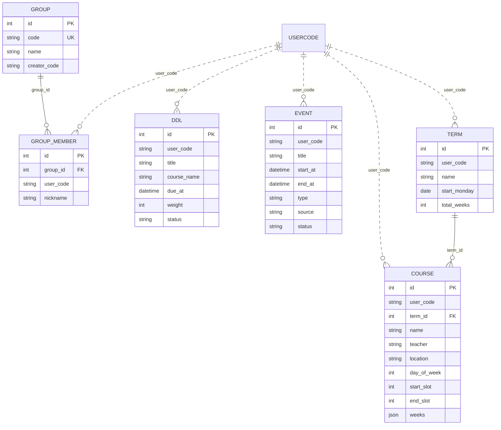

# 数据库设计说明书

项目名称：大学生日程管理工具 ｜ 版本：v0.2 ｜ 日期：2026-11-07 ｜ 数据库：SQLite（ORM：SQLAlchemy 2.0）

---

## 1. 实体关系图（ER）

> 注：骨架版不做账号系统，`USERCODE`（虚线实体）为客户端首次启动生成并持久化的随机串，经 `X-User` 请求头传递，逻辑上等价于用户主键。上线版替换为正式用户表。

## 2. 表结构明细

### 2.1 terms（学期）

| 字段 | 类型 | 约束 | 说明 |
|------|------|------|------|
| id | INTEGER | PK, 自增 | |
| user_code | VARCHAR(64) | 索引 | 逻辑用户 |
| name | VARCHAR(64) | 默认"本学期" | 学期名，如"2026 秋" |
| start_monday | DATE | 非空 | 第 1 教学周的周一（教学周推算基准） |
| total_weeks | INTEGER | 默认 20 | 学期总周数 |

### 2.2 courses（课程）

| 字段 | 类型 | 约束 | 说明 |
|------|------|------|------|
| id | INTEGER | PK, 自增 | |
| user_code | VARCHAR(64) | 索引 | |
| term_id | INTEGER | FK → terms.id | |
| name | VARCHAR(128) | 非空 | 课程名 |
| teacher | VARCHAR(64) | 默认空 | 教师 |
| location | VARCHAR(128) | 默认空 | 上课地点 |
| day_of_week | INTEGER | 1–7 | 周几（1=周一） |
| start_slot | INTEGER | 1–12 | 起始节次 |
| end_slot | INTEGER | 1–12 | 结束节次 |
| weeks | JSON | 数组 | 上课周次，如 `[1,3,5,…,17]` 表示单周课 |

### 2.3 events（日程/挡时间/群组定档）

| 字段 | 类型 | 约束 | 说明 |
|------|------|------|------|
| id | INTEGER | PK, 自增 | |
| user_code | VARCHAR(64) | 索引 | |
| title | VARCHAR(128) | 非空 | 挡时间时为"我有安排" |
| start_at / end_at | DATETIME | 非空 | |
| type | VARCHAR(16) | temp / suggestion / group / **block** | block=手动挡时间，计入忙闲但不算正式日程 |
| source | VARCHAR(16) | voice / text / ddl / group | 来源，用于统计 |
| status | VARCHAR(16) | ok / canceled / **pending / conflict** | 群组定档：定档先 pending，确认后 ok，冲突标 conflict |

### 2.4 ddls（截止任务）

| 字段 | 类型 | 约束 | 说明 |
|------|------|------|------|
| id | INTEGER | PK, 自增 | |
| user_code | VARCHAR(64) | 索引 | |
| title | VARCHAR(128) | 非空 | 任务名 |
| course_name | VARCHAR(128) | 默认空 | 关联课程名（字符串弱关联，避免骨架版建强外键） |
| due_at | DATETIME | 非空 | 截止时间 |
| weight | INTEGER | 1/2/3 | 重要度：低/中/高（影响倒计时墙分档与推荐打分） |
| status | VARCHAR(16) | open / done / overdue | |

### 2.5 groups（组）

| 字段 | 类型 | 约束 | 说明 |
|------|------|------|------|
| id | INTEGER | PK, 自增 | |
| code | VARCHAR(8) | 唯一索引 | 进组口令（邀请链接参数），随机生成 |
| name | VARCHAR(64) | | 组名，如"寝室 302" |
| creator_code | VARCHAR(64) | | 组长 user_code |

### 2.6 group_members（组成员）

| 字段 | 类型 | 约束 | 说明 |
|------|------|------|------|
| id | INTEGER | PK, 自增 | |
| group_id | INTEGER | FK → groups.id, 索引 | |
| user_code | VARCHAR(64) | 索引 | |
| nickname | VARCHAR(32) | | 组内昵称（进组时填一次） |

## 3. 设计要点与理由

1. **weeks 用 JSON 数组而非起止周+奇偶**：表达力覆盖"任意周次组合"（含跨段 `[1..8, 11..16]`），单双周只是特例；前端渲染和位图计算都是一次 `in` 判断。
2. **user_code 逻辑用户**：四天骨架不做注册登录（大学生推广的最大摩擦），客户端 localStorage 持久化随机串；表结构已按 user_code 隔离，升级登录系统时加 users 表 + 迁移即可，不动业务表。
3. **挡时间复用 events（type=block）**：不另建表。挡时间本质就是"无名忙碌时段"，忙闲计算统一从 events 取数。
4. **定档确认状态机**：`settle → 全员 pending → 逐人 ok / conflict`，用 events.status 表达，避免骨架版引入群组消息表。
5. **DDL 与课程弱关联（course_name 字符串）**：DDL 可能来自粘贴的群通知，未必对应课表里的课；强外键会丢数据。
6. **忙闲位图不落库**：每次查询由课程+日程实时计算（学生量级毫秒级），避免缓存一致性问题；后续量大再加缓存。

## 4. 后续演进（骨架版之后）

- users 表（微信/手机号登录）+ user_code 映射迁移
- slot_times 节次时刻表（每校自定义作息）
- suggestion_feedbacks 表（推荐反馈，支撑学习型推荐）
- group_events 独立（若确认流变复杂，引入消息通知表）
