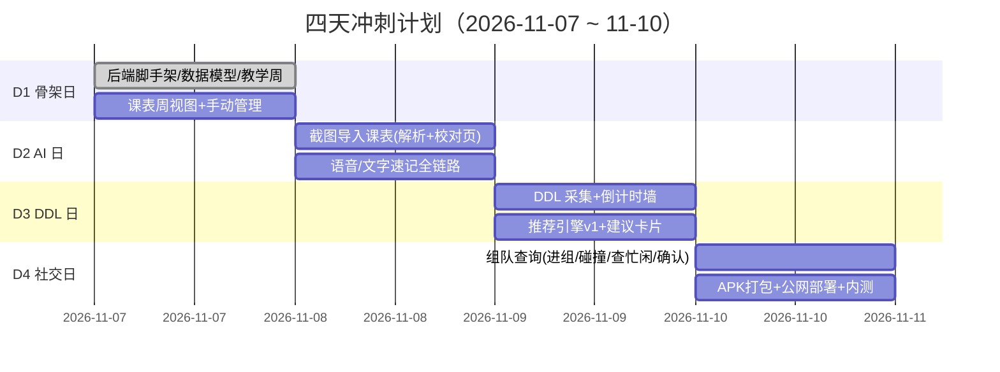

# 项目计划（四天冲刺版）

项目名称：大学生日程管理工具 ｜ 制定日期：2026-11-07 ｜ 约束：1 人 + AI 辅助，4 天交付可演示骨架

---

## 1. 目标与范围

**目标**：四天产出可安装、可演示、可给宿舍真实使用的骨架——四个 P0 功能全部最小闭环。

**明确砍掉**（赛后有余力再做）：WakeUp/.ics 格式兼容、专注打卡、学期报告、成绩计算器、LLM 子任务拆解、消息推送。

## 2. 里程碑与甘特图

## 3. 每日验收标准

| 天 | 验收（达不成就砍功能不砍验收） |
|----|------|
| D1 | 手机浏览器打开 H5，学期设置正确返回教学周，课表手动增删改 + 周视图单双周显隐正确 |
| D2 | 真实教务截图导入并校对入库成功；一句"明天下午没课提醒我取快递"生成正确日程 |
| D3 | 粘贴群通知抽取 DDL 成功；一个 DDL 从录入 → 收到建议 → 点接受进日程全链路通 |
| D4 | 4 人（含 1 人异地 H5）建组 → 查周六下午忙闲 → 定档 → 全员确认 → 日程落库；APK 装机跑通 |

## 4. 当前状态（D2 进行中，2026-11-08）

- ✅ 后端脚手架：FastAPI + SQLAlchemy + SQLite，7 张表建好
- ✅ 接口：学期设置（含教学周推算）、课程 CRUD、批量入库——冒烟测试通过
- ✅ PRD / SRS / 概设 / 数据库设计文档
- ✅ D1 课表周视图 + 手动管理（手机 H5 验收通过）
- ✅ D2 课表导入：教务 docx/xlsx 文件（确定性解析）/ 粘贴文本（规则）/ 截图（LLM 通道，待 Key）
- ✅ D2 速记：一句话速记规则解析 26/26 + **群通知长文本解析器**（微信复制通知 → 标题/时段/地点/路径备注，6/6 真实样例通过）
- ✅ D2+ 日程小图标（emoji 自选，课表块/速记列表显示）
- ✅ D2+ 冲突检测：保存日程前自动对照课表+已有日程，只提醒不阻断（smoke_conflict 12/12）
- ✅ D2+ 临时调课/停课：点课卡片 → 编辑 / 第N周停课 / 第N周调课（原课去周 + 新建单周记录，支持跨周）
- ✅ D2+ 时间确定度四档：准点 / 仅开始 / 大概 / 待定（通知解析自动判定，表单可改，非准点不参与冲突检测）
- ✅ D2+ 手机适配双模式：竖屏关键信息（课名两行）/ 横屏完整信息，旋转即时切换（uni.onWindowResize）
- ✅ D2+ 个人主页 `/pages/profile`：昵称档案（profiles 表，为 D4 群组预留）+ 口令查看复制 + 新学期重置/清空日程 + 日程列表 + 课表改动记录（courses.remark 标记调课/停课）+ 群组占位
- 🔄 LLM/ASR Key：**全部延后**，无 Key 架构已全量可用，Key 只作增强（接口已留好）
- ⬜ D3 DDL 中枢 + 推荐引擎
- ⬜ D4 组队碰撞 + 打包部署

## 5. 依赖与准备清单

| 事项 | 用途 | 状态 |
|------|------|------|
| 多模态 LLM API Key（GLM-4V / Qwen-VL） | D2 课表/DDL 解析 | ⬜ 待申请 |
| HBuilderX + 免费账号 | D4 云打包 APK | ⬜ 待安装 |
| Android 手机 + 数据线 | 真机调试 | — |
| 内网穿透（cpolar 等）或云服务器 | D4 组队功能公网演示 | ⬜ 待准备 |

## 6. 风险与对策

| 风险 | 等级 | 对策 |
|------|------|------|
| GitHub 不可达（已发生） | 已解决 | 改用 gitee 镜像拉取 uni-app 模板；npm 走 npmmirror |
| 教务系统截图格式千差万别，解析不全对 | 高 | 产品上强制走校对页，解析 90% 准 + 3 秒改完即达标 |
| LLM Key 申请/额度耽误 D2 | 中 | 今日（D1 晚）就申请；兜底：先造模拟解析数据跑通链路，Key 到位切换 |
| APK 打包/签名不熟 | 中 | D4 下午留足时间；打不出则 H5 完整演示，不阻塞验收 |
| 手机浏览器麦克风权限（安全上下文限制） | 低 | 开发期 `adb reverse` 走 localhost；文字输入兜底 |
| 四天范围蔓延 | 高 | 每日验收表为准；新想法一律进"赛后清单"不进本周 |

## 7. 交付物清单

1. 源码：`server/`（后端）+ `app/`（uni-app 前端）
2. Android APK + H5 可访问地址
3. 工程文档：PRD、SRS、概要设计、数据库设计、本项目计划（`prd.md` 与 `docs/`）
4. 接口文档：运行时 Swagger（`/docs`）
5. 演示脚本：拍课表导入 → 语音速记 → DDL 建议接受 → 4 人组队定档确认（含 1 人异地）
